# 🎓 TermChin | ترم‌چین — دستیار هوشمند انتخاب واحد دانشگاه

[](https://www.android.com/)
[](https://github.com/Ara-0x/TermChin/releases)
[](https://kotlinlang.org)
[](https://developer.android.com/jetpack/compose)
[]()
[]()
[]()
[](LICENSE)

> **ترم‌چین (TermChin)** — ترمت رو هوشمندانه بچین!  
> پایان دغدغه تداخل ساعتی کلاس‌ها و امتحانات. بررسی تمام سناریوهای انتخاب واحد و چیدمان خودکار بهترین برنامه هفتگی در چند ثانیه.

**TermChin** یک اپلیکیشن اندرویدی مدرن و بومی است که کار می‌کند با یک استثنای باریک: یک درخواست HTTPS ناشناس، بدون ورود به حساب و بدون هیچ داده‌ی کاربر به `api.github.com` برای اطلاع از انتشار نسخه‌ی جدید (جزئیات: `docs/SECURITY.md`)؛ و `android:allowBackup="false"` نیز پشتیبان‌گیری خودکار سیستم‌عامل (ابر یا انتقال بین دستگاه‌ها) را خاموش می‌کند. در نتیجه داده‌های شما (دروس، برنامهٔ هفتگی، جزوات، تنظیمات) روی دستگاه خودتان می‌مانند و تنها راه پشتیبان‌گیری، **«خروجی JSON» از داخل خود اپ** است که خودتان جایی ذخیره می‌کنید. تنها راه ورود داده نیز فایل‌هایی است که خودتان انتخاب می‌کنید (HTML/MHT ذخیره‌شده از پرتال، CSV/JSON). دانشجو می‌تواند دروس ارائه‌شدهٔ دانشکده و گروه‌های درسی را وارد کند و با یک کلیک، برنامه‌های بدون تداخل را مرتب‌شده ببیند.

رابط کاربری به‌طور اختصاصی برای زبان فارسی (راست‌چین RTL) با فریم‌ورک **Jetpack Compose Material 3** و فونت خوانای **وزیرمتن** پیاده‌سازی شده است.

اگر می‌خواهید پیش از نصب، فضای بصری برنامه را ببینید، بخش [📸 نمای برنامه](#-نمای-برنامه) را باز کنید.

---

## 📑 فهرست مطالب
- [📸 نمای برنامه](#-نمای-برنامه)
- [✨ ویژگی‌ها و امکانات](#-ویژگیها-و-امکانات)
- [🛠 معماری و تکنولوژی‌ها](#-معماری-و-تکنولوژیها)
- [📂 ساختار پروژه](#-ساختار-پروژه)
- [🚀 راه‌اندازی و بیلد](#-راهاندازی-و-بیلد)
- [📦 دریافت نسخه نهایی (APK)](#-دریافت-نسخه-نهایی-apk)
- [🤝 مشارکت (Contributing)](#-مشارکت-contributing)
- [📄 لایسنس (License)](#-لایسنس-license)

---

## 📸 نمای برنامه

قبل از نصب، فضای بصری ترم‌چین را ببینید — رابط کاربری راست‌چین، پالت رنگی آرام و پشتیبانی کامل از حالت روشن و تاریک.

| 🏠 خانه | 🌙 تم تاریک | 🧭 شروع تازه |
|:---:|:---:|:---:|
| <a href="docs/screenshots/home-light.png">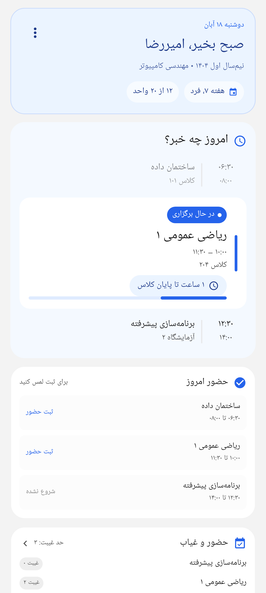</a> | <a href="docs/screenshots/home-dark.png">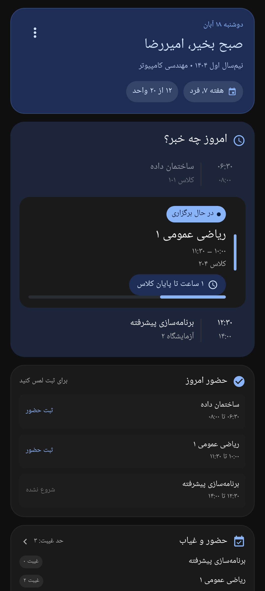</a> | <a href="docs/screenshots/home-empty-light.png">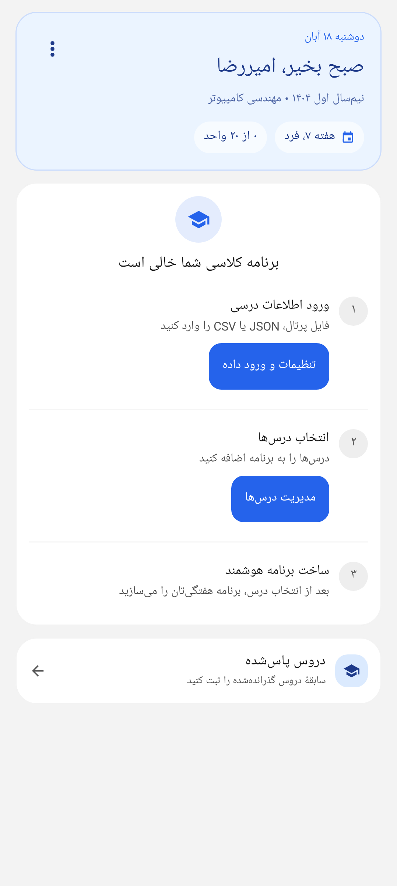</a> |
| <sub>کلاس امروز، آمار ترم و امتحانات</sub> | <sub>همان چیدمان در تم تاریک</sub> | <sub>راهنمای گام‌به‌گام برای شروع</sub> |

| 📚 دروس | 🗓 برنامه‌ساز | 📝 جزوات |
|:---:|:---:|:---:|
| <a href="docs/screenshots/courses-light.png">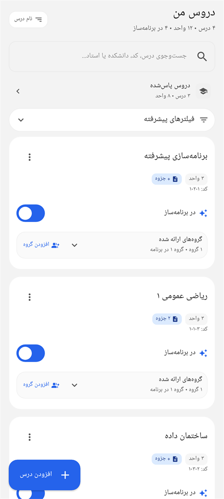</a> | <a href="docs/screenshots/schedule-light.png">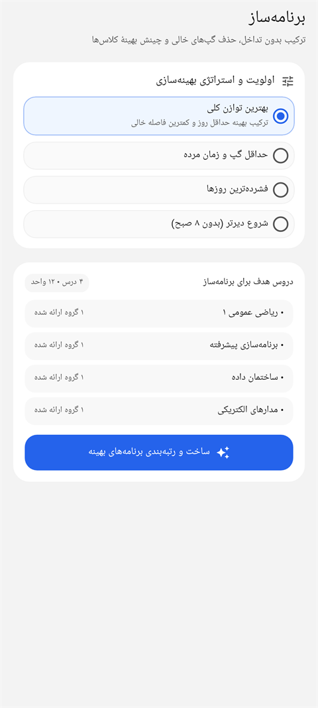</a> | <a href="docs/screenshots/documents-light.png">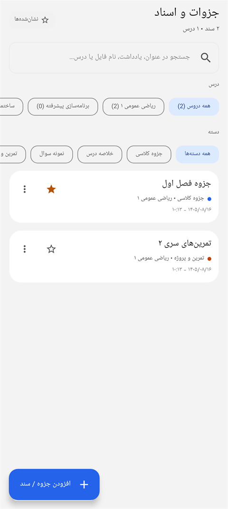</a> |
| <sub>گروه‌ها، تداخل و انتخاب برای برنامه‌ساز</sub> | <sub>اولویت‌ها و ساخت برنامه‌های بهینه</sub> | <sub>آرشیو دسته‌بندی‌شدهٔ جزوات</sub> |

| ➕ افزودن درس | ✅ حضور و غیاب |
|:---:|:---:|
| <a href="docs/screenshots/add-course-light.png">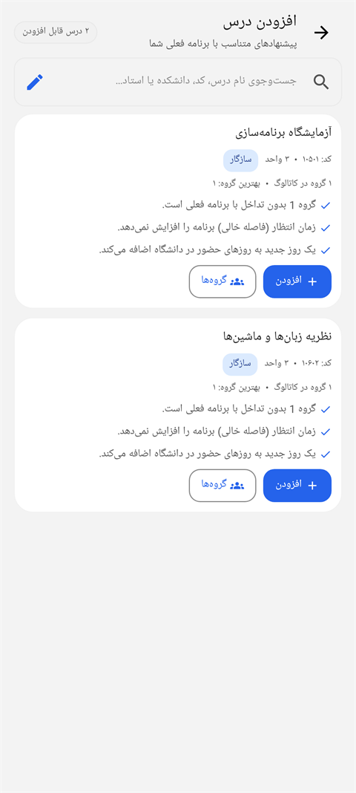</a> | <a href="docs/screenshots/attendance-light.png">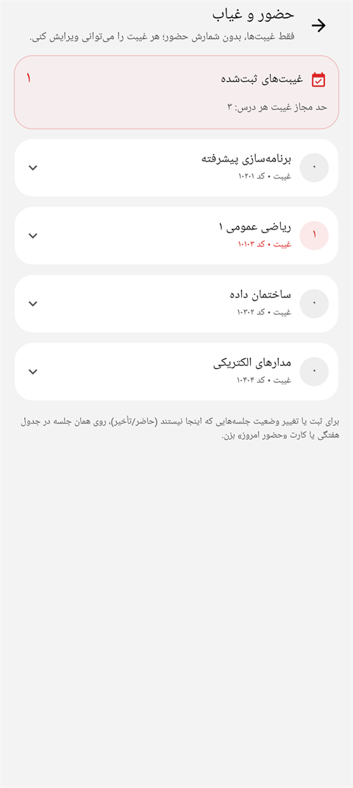</a> |
| <sub>پیشنهادهای سازگار با برنامهٔ فعلی</sub> | <sub>ثبت غیبت‌ها با حد مجاز هر درس</sub> |

| ⚙️ تنظیمات | 🌙 تنظیمات در تم تاریک | 📥 مدیریت داده‌ها |
|:---:|:---:|:---:|
| <a href="docs/screenshots/settings-light.png">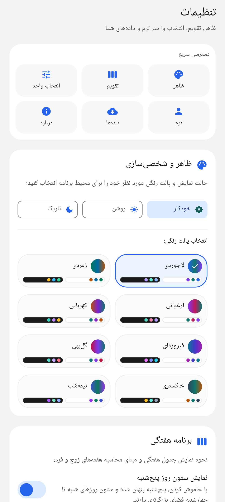</a> | <a href="docs/screenshots/settings-dark.png">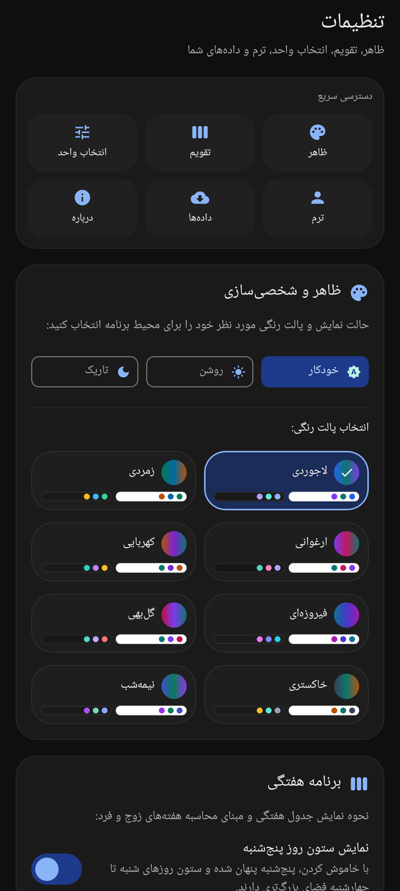</a> | <a href="docs/screenshots/settings-data.png">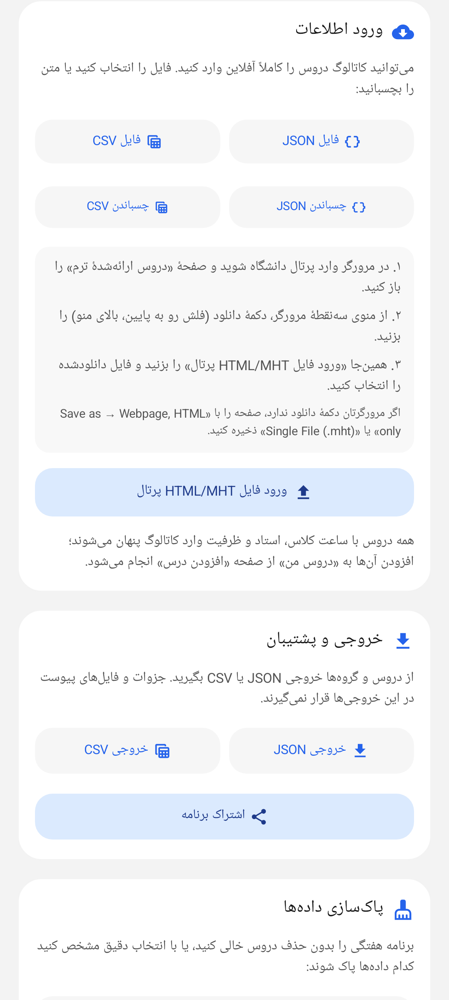</a> |
| <sub>دسترسی سریع، حالت نمایش و پالت‌های روشن/تاریک</sub> | <sub>همان چیدمان در تم تاریک</sub> | <sub>ورود پرتال، JSON/CSV، خروجی و پاک‌سازی</sub> |

| 🏁 پایان ترم | 🎓 دروس پاس‌شده | 📊 سوابق تحصیلی |
|:---:|:---:|:---:|
| <a href="docs/screenshots/end-term-light.png">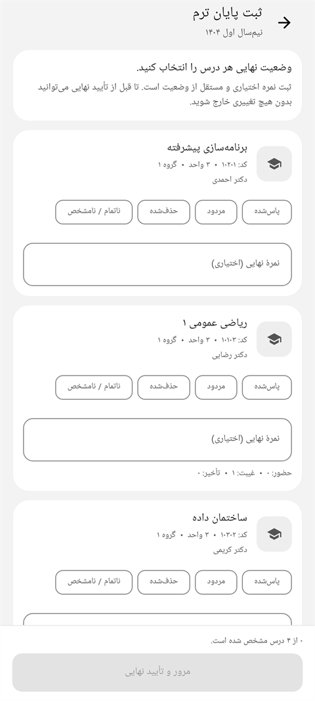</a> | <a href="docs/screenshots/passed-courses-light.png">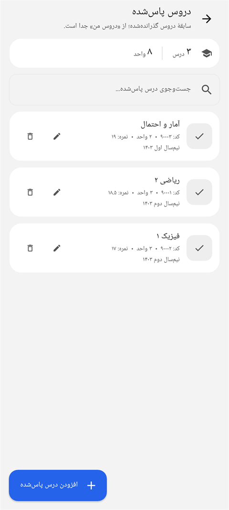</a> | <a href="docs/screenshots/academic-records-light.png">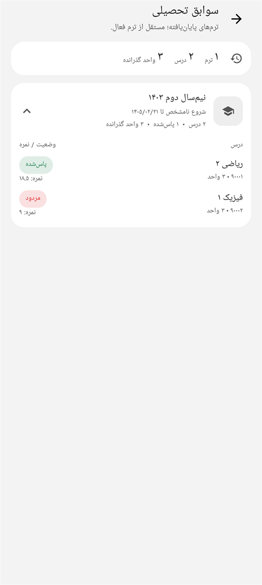</a> |
| <sub>وضعیت نهایی هر درس و نمرهٔ اختیاری</sub> | <sub>سابقهٔ دروس گذرانده‌شده</sub> | <sub>ترم‌های پایان‌یافته و کارنامه</sub> |

| 🔄 به‌روزرسانی | ⬇️ دانلود داخل برنامه | ✅ آمادهٔ نصب |
|:---:|:---:|:---:|
| <a href="docs/screenshots/update-dialog-light.png">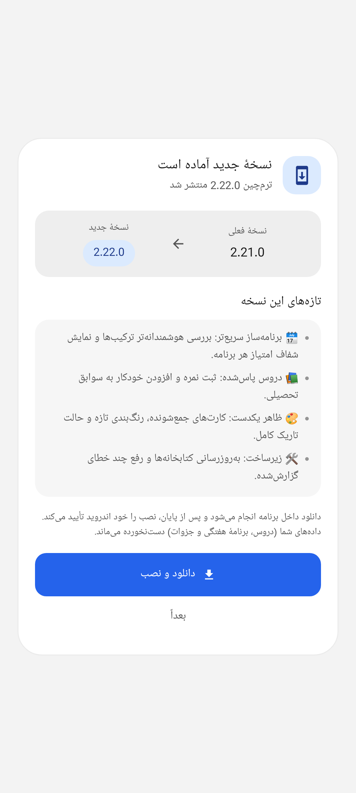</a> | <a href="docs/screenshots/update-dialog-downloading.png">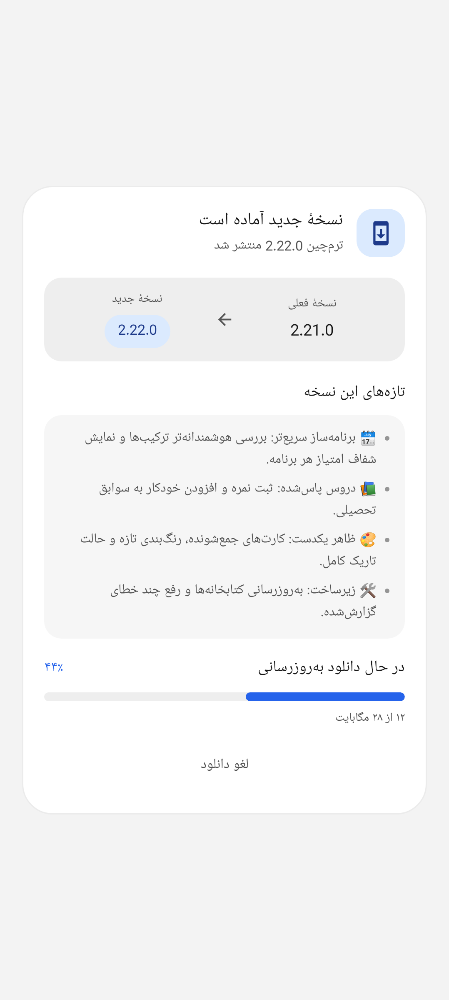</a> | <a href="docs/screenshots/update-dialog-ready.png">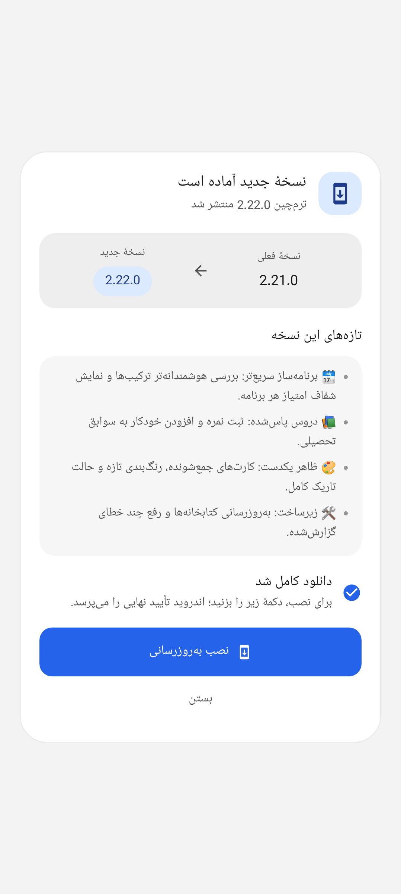</a> |
| <sub>نسخهٔ جدید، مقایسه و تغییرات</sub> | <sub>پیشرفت زنده و امکان لغو</sub> | <sub>نصب با تأیید اندروید</sub> |

| 🗓 تقویم هفتگی | 🧩 نمای کل هفته | 🌙 تقویم در تم تاریک |
|:---:|:---:|:---:|
| <a href="docs/screenshots/calendar-day-light.png">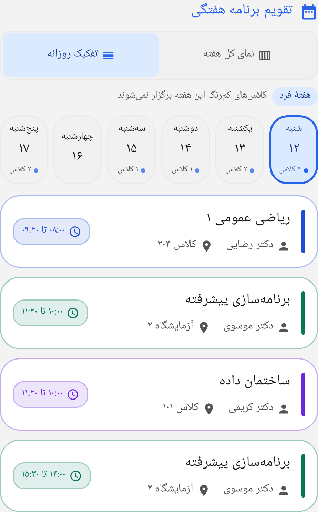</a> | <a href="docs/screenshots/calendar-grid-light.png">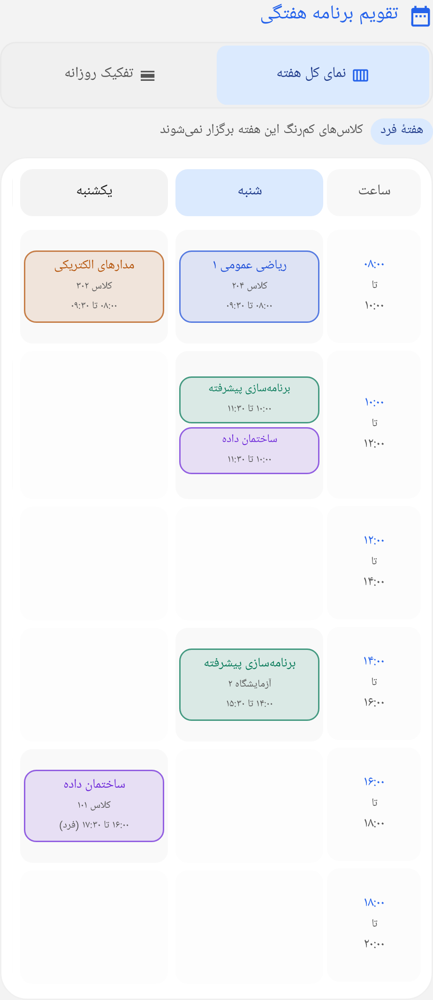</a> | <a href="docs/screenshots/calendar-day-dark.png">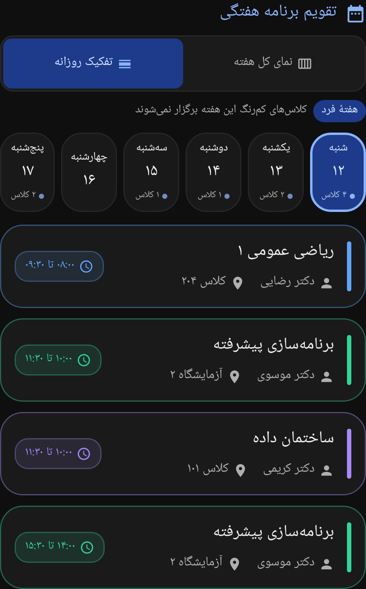</a> |
| <sub>هر شش روز، تعداد کلاس و روز انتخاب‌شده</sub> | <sub>ستون ساعت ثابت و برجسته‌سازی امروز</sub> | <sub>همان چیدمان در تم تاریک</sub> |

| 👋 کارت خوش‌آمد | 🌙 همان کارت در تم تاریک | 🏁 پایان ترم |
|:---:|:---:|:---:|
| <a href="docs/screenshots/greeting-light.png">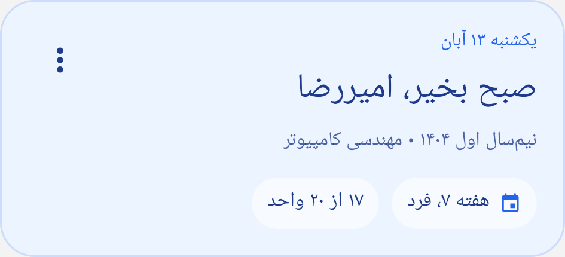</a> | <a href="docs/screenshots/greeting-dark.png">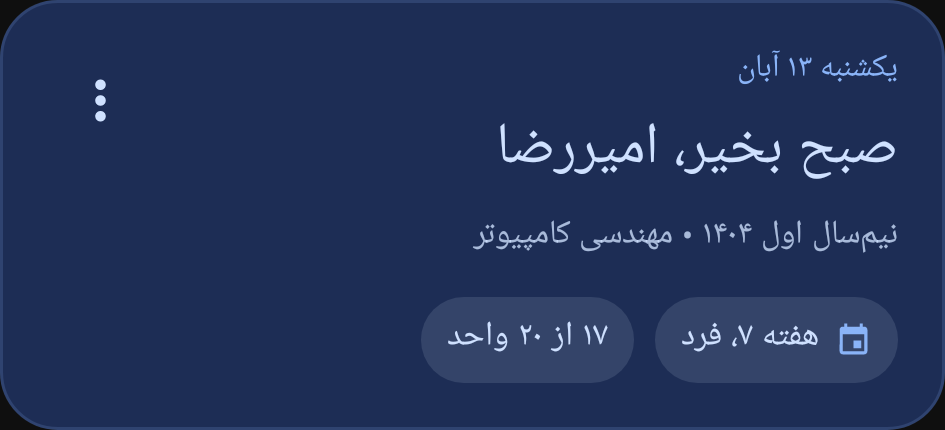</a> | <a href="docs/screenshots/greeting-term-ended.png">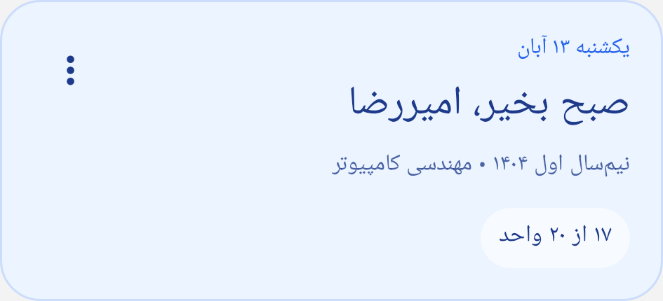</a> |
| <sub>تاریخ شمسی، سلام، هفته و بار واحد</sub> | <sub>چیپ‌های روشن‌تر از کارت در تم تاریک</sub> | <sub>بدون هفتهٔ آرشیوشدهٔ گمراه‌کننده</sub> |

---

## ✨ ویژگی‌ها و امکانات

### ۱. 🧠 برنامه‌ساز خودکار هوشمند (Smart Schedule Engine)
- **تولید برنامه بهینه:** جستجوی Backtracking با مرتب‌سازی شاخه‌و-بُران که ترکیب‌های بدون تداخل را بررسی و **۱۲ برنامهٔ برتر (Top-K)** را نگه می‌دارد.
- **صادق بودن نتیجه:** خروجی به‌صورت شفاف یکی از این دو حالت را نشان می‌دهد:
  - «همهٔ ترکیب‌ها بررسی شد»، یا
  - «جست‌وجو به **سقف امن (`maxLeaves` ≈ ۲۰۰هزار برگ)** رسید و بهترین‌های یافت‌شده نمایش داده می‌شود» — یعنی در فضاهای بسیار بزرگ ممکن است ترکیبِ بهینهٔ مطلق پیدا نشود و اپ همین را صریحاً اعلام می‌کند (ادعای «بررسی همهٔ حالت‌ها بدون استثنا» را نداریم).
- **نتیجهٔ ناقص، اعمال نمی‌شود:** اگر برای درسی از دروس انتخاب‌شده هیچ گروه قابل‌استفاده‌ای پیدا نشود، نام آن درس در نتیجه گزارش می‌شود ولی دکمهٔ «اعمال» **غیرفعال** می‌ماند تا برنامهٔ کامل فعلی‌تان با یک برنامهٔ ناقص جایگزین نشود.
- **۴ معیار رتبه‌بندی و اولویت‌بندی:**
  - ⚖️ **توازن کلی:** پخش یکنواخت ساعات درسی در ایام هفته.
  - ⏱️ **حداقل گپ:** کاهش زمان‌های بیکاری بین جلسات.
  - 📦 **روزهای فشرده:** متمرکز کردن کلاس‌ها در کمترین تعداد روز.
  - ☀️ **بدون ۸ صبح:** حذف یا کاهش کلاس‌های اول وقت صبحگاهی.
- **شفافیت امتیاز:** دکمهٔ «چرا این برنامه؟» زیر هر پیشنهاد، شکست کامل امتیاز (امتیاز خام، ردیف‌های توضیح و ردیف‌های «محدودسازی») را نشان می‌دهد؛ جمع ردیف‌های توضیح همیشه برابر امتیاز نمایش‌داده‌شده است.

### ۲. 🔍 تشخیص تداخل (Conflict Detection)
- تشخیص دقیق هم‌پوشانی ساعت کلاس‌ها با رعایت مرز زمانی.
- پشتیبانی کامل از کلاس‌های **هفته زوج / فرد**.
- بررسی تداخل روز و بازه ساعتی امتحانات پایان‌ترم.

### ۳. 📚 مدیریت دروس و گروه‌ها
- **کشف هوشمند درس:** دکمهٔ «افزودن درس» صفحهٔ پیشنهادها را باز می‌کند — ۵ پیشنهاد سازگار با برنامهٔ فعلی (بدون تداخل، کمترین گپ، کمترین روز اضافه) با دلیل محاسبه‌شده، به‌علاوهٔ کل کاتالوگ قابل جست‌وجو (نام، کد، دانشکده، استاد)؛ انتخاب گروه از میان گروه‌های واقعی همان درس با نمایش وضعیت تداخل.
- ثبت درس با مشخصات کد، نام، واحد، گروه (سکشن)، استاد و محل برگزاری (فرم دستی همچنان در دسترس است).
- **ویرایش درس** (نام، کد، دانشکده، واحد) بدون حذف و ثبت مجدد؛ گروه‌ها، ثبت‌نام‌ها و جزوات حفظ می‌شوند.
- تعریف چندین جلسه در هفته برای هر گروه.
- جستجوی آنی و فیلتر بر اساس نام، کد، واحد، مقطع و روز کلاس؛ نتایج کاتالوگ همگی قابل اسکرول‌اند.
- **نمایش نام کامل درس در کارت:** هدر کارت درس سه‌ردیفه است (نام تمام‌عرض دولاینه + چیپ‌ها + ردیف کد/دانشکده) تا نام‌های بلند فارسی بریده نشوند.

### ۴. 📝 آرشیو جزوات و اسناد
- دسته‌بندی و الصاق جزوات، اسلایدها و منابع **فقط برای دروس انتخاب‌شده و نهایی‌شده**.
- پشتیبانی از فایل‌های دستگاه با قابلیت نشان‌کردن (Bookmark) و فیلتر سریع.
- ۶ دسته‌بندی: جزوه کلاسی، خلاصه درس، نمونه سوال، تمرین و پروژه، اسلاید و رفرنس، یادداشت مهم.

### ۵. 📅 تقویم هفتگی هوشمند
- نمایش جدول زمانی هفتگی با بازه‌های **۲ ساعته** (۸ تا ۱۰، ۱۰ تا ۱۲، ۱۲ تا ۱۴، ۱۴ تا ۱۶، ۱۶ تا ۱۸، ۱۸ تا ۲۰).
- **هفته زوج/فرد آموزشی:** با ثبت تاریخ شروع کلاس‌ها در تنظیمات، اپ هفته جاری را تشخیص می‌دهد؛ کلاس‌هایی که این هفته تشکیل نمی‌شوند کم‌رنگ نمایش داده می‌شوند و گپ و ساعت هفتگی با احتساب زوج/فرد محاسبه می‌شود.
- دو حالت نمایش: نمای کل هفته (Grid) و تفکیک روزانه (Day View). در تفکیک روزانه هر شش روز هفته همیشه کامل دیده می‌شوند (بدون بریدگی)، هر روز تعداد کلاس‌هایش را نشان می‌دهد و روز انتخاب‌شده همان روزی است که لیست کلاس‌هایش پایین نمایش داده می‌شود؛ در نمای کل هفته ستون ساعت هنگام اسکرول ثابت می‌ماند و ستون «امروز» برجسته است.
- تنظیم چگالی جدول برای صفحات نمایش مختلف.

### ۶. 🏠 داشبورد خانه (Home)
- **کارت خوش‌آمدِ زمان‌آگاه:** تاریخ شمسی امروز، سلامِ صبح/ظهر/عصر/شب، نیمسال و رشته در یک کارت آرام جمع شده‌اند؛ چیپ‌های «هفتهٔ آموزشی» و «بار واحد» فقط واقعیت‌های جاری را نشان می‌دهند (پس از «ثبت پایان ترم» چیپ هفتهٔ آرشیوشده پنهان می‌شود) و در فونت بزرگ به‌جای بریده‌شدن به خط بعد می‌روند. سلام به‌عنوان heading برای TalkBack علامت‌گذاری شده است.
- **کارت «امروز» زنده:** کلاسِ در حال برگزاری یا کلاس بعدی را مقدم نشان می‌دهد — به‌صورت آگاه از هفتهٔ زوج/فرد (جلسهٔ خارج از هفتهٔ جاری هرگز «امروز/در حال برگزاری» نشان داده نمی‌شود)؛ دکمهٔ «مشاهده برنامه هفتگی» به تقویم همین صفحه اسکرول می‌کند و کلاس در حال برگزاری هرگز کاربر را به برنامه‌ساز نمی‌برد.
- **۴ کارت آماری رنگی:** تعداد درس‌ها، مجموع واحدها، روزهای کلاسی و زمان مرده (گپ) هفته.
- **نوار پیشرفت واحد:** «X از Y واحد هدف» بر اساس هدفِ واحدِ تنظیم‌شده در تنظیمات.
- **برنامهٔ زمانی امتحانات پایان‌ترم:** فهرست امتحانات ثبت‌شده به‌ترتیب تاریخ، با هشدار قرمزِ تداخل امتحانات و هشدارِ ساعت نامشخص.
- **کارت راهنمای کاربر تازه:** تا وقتی درسی ثبت نشده، گام‌های شروع را قدم‌به‌قدم نشان می‌دهد (به‌جای نمایش کارت‌های صفر).
- نشانگر «آفلاین» و بنر دسترسی سریع به جزواتِ دروس نهایی‌شده.

### ۷. 📤 ورودی و خروجی داده‌ها
- ایمپورت و اکسپورت از طریق فایل‌های **CSV** و **JSON**.
- **دکمهٔ «کپی» در دیالوگ خروجی JSON:** کل متن JSON را در کلیپ‌بورد کپی می‌کند تا بکاپ گرفتن بیرون از گوشی راحت باشد.
- کپی متنی و اشتراک‌گذاری جدول زمان‌بندی هفتگی.

### ۸. 🎨 شخصی‌سازی و رابط کاربری
- طراحی اختصاصی بر پایه **Material Design 3**.
- پشتیبانی کامل از **Dark Mode** و **Light Mode**.
- ۸ تم رنگی جذاب با فونت خوانای **وزیرمتن (Vazirmatn)** — هر تم یک primary / ‏secondary / ‏tertiary متمایز دارد (با فاصلهٔ رنگی کنترل‌شده، تست خودکار ≥ ۲۰ درجه) و **کرومِ صفحه خنثی (طوسی)** است: پس‌زمینه، کارت‌ها، متن‌ها و خطوط رنگِ تم را نمی‌گیرند تا اکسنت‌ها بدرخشند (تست خودکار chroma ≤ ۶)؛ جداسازی کارت از صفحه (~۱.۱۱) هم یکدست می‌ماند.
- **تنظیماتِ آرام و قابل‌اسکن:** شش دسته با «دسترسی سریع»، چیپ‌های یک‌خطی حالت نمایش (خودکار/روشن/تاریک)، پالت‌ها با پیش‌نمایش روشن و تاریک، تراکم جدول، معیارهای انتخاب واحد که در دو خط می‌پیچند (بدون بریدگی افقی)، و پروفایل با ارقام فارسی، ردیف‌های مقاوم و دکمه‌های تونال به‌جای دیوار دکمه‌های خط‌دار.

### ۹. 📥 دریافت داده از پرتال دانشگاه (بدون ورود خودکار)
- **ایمپورت فایل HTML یا تک‌فایل `.mht` پرتال (پویا / گلستان / سما):** خودتان در مرورگر وارد پرتال می‌شوید، صفحهٔ «دروس ارائه‌شدهٔ ترم» را با دکمهٔ دانلود مرورگر (یا `Save as → Webpage, HTML only` / `Single File`) ذخیره می‌کنید و همان فایل را در اپ انتخاب می‌کنید (اثبات‌شده روی فایل واقعی پرتال — ۱۵۷ درس).
- **پردازش کاملاً محلی، بایت‌به‌بایت:** اپ فایل را به‌صورت محلی و بایت‌سطح می‌خواند و دروس را استخراج می‌کند؛ تصاویرِ بایتِ خام داخل ذخیره‌های تک‌فایل، متن جدول را خراب نمی‌کند. هیچ ورود به حساب، هیچ مرورگر داخلی و هیچ درخواست شبکه‌ای دیگری وجود ندارد.
- افزودن دروس از کاتالوگ به لیست شخصی با جستجوی **کد درس**.
- **کنترل سقف مجاز واحد:** هشدار هوشمند بر اساس وضعیت تحصیلی (مشروط ۱۴، عادی ۲۰، معدل الف ۲۴ واحد).
- پشتیبان‌گیری ۱۰۰٪ آفلاین و محلی.

---

## 🛠 معماری و تکنولوژی‌ها

| فناوری | جزئیات |
|---|---|
| **زبان** | Kotlin 2.2.10 • Java 17 |
| **بیلد** | Android Gradle Plugin (AGP) 9.1.1 • KSP 2.3.5 |
| **رابط کاربری** | Jetpack Compose — Material 3 |
| **معماری** | MVVM + Repository Pattern + Compose UI |
| **تزریق وابستگی** | Dagger Hilt 2.60.1 |
| **پایگاه داده** | Room 2.7.0 + Migrations |
| **تنظیمات** | Jetpack DataStore Preferences |
| **همزمانی** | Kotlin Coroutines & StateFlow |

---

## 📂 ساختار پروژه

```text
ir.courseplanner.app/
├── MainActivity.kt               # نقطه شروع، Compose Host و ناوبری اصلی
├── CoursePlannerApplication.kt   # کلاس اصلی اپلیکیشن (@HiltAndroidApp)
├── data/
│   ├── local/                    # دیتابیس Room، جداول و DAOها
│   ├── model/                    # مدل‌های داده‌ای (Course, Section, Session, Document)
│   ├── repository/               # مخزن داده و مدیریت تراکنش‌ها
│   ├── importer/                 # پردازش CSV/JSON و HTML/MHT پرتال (MhtHtmlExtractor)
│   └── preferences/              # مدیریت تنظیمات کاربر با DataStore
├── di/                           # ماژول‌های Hilt
├── engine/                       # موتور برنامه‌سازی هوشمند (ScheduleEngine) و اعتبارسنجی گروه‌ها
├── ui/
│   ├── CoursePlannerViewModel.kt # مدیریت State و منطق View
│   ├── screens/                  # صفحات (Home, Courses, Schedule, Documents, Settings)
│   ├── components/               # کامپوننت‌ها (جدول هفتگی، دیالوگ‌ها)
│   └── theme/                    # رنگ‌ها، تایپوگرافی و تم‌های هشت‌گانه
└── util/                         # توابع کمکی (زمان، اکسپورت)
```

---

## 🚀 راه‌اندازی و بیلد

### پیش‌نیازها
- **JDK 25** (دیمن Gradle با `gradle/gradle-daemon-jvm.properties` روی ۲۵ پین شده است)
- **Android SDK Platform 36.1** (حداقل API 24)
- **Android Studio Koala یا جدیدتر**

### مراحل بیلد

```bash
# ۱. کلون کردن مخزن
git clone https://github.com/Ara-0x/TermChin.git
cd TermChin

# ۲. تنظیم local.properties (در صورت نیاز)
# sdk.dir=C\:\\Users\\<Username>\\AppData\\Local\\Android\\Sdk

# ۳. بیلد نسخه دیباگ
# ویندوز:
.\gradlew assembleDebug
# لینوکس / مک:
./gradlew assembleDebug

# ۴. اجرای تست‌ها
./gradlew testDebugUnitTest
```

> ## ⚠️ اطلاعیهٔ مهم — حذف و نصب مجدد فقط برای نصب‌های قدیمی (تا v2.5.0)
>
> کلید امضای TermChin در نسخهٔ **2.6.0** عوض شد (`CN=Android Debug` ← `CN=TermChin Release`)؛ این یک تصمیم امنیتی آگاهانه بود، چون کلید امضای قدیمی در تاریخچهٔ عمومی مخزن افشا و بازنشسته شده است. بنابراین:
>
> - اگر روی گوشی شما نسخه‌ای **تا v2.5.0** نصب است، نسخه‌های جدید روی آن نصب *نمی‌شوند* و اندروید خطای «برنامه نصب نشد» (`INSTALL_FAILED_UPDATE_INCOMPATIBLE`) می‌دهد.
> - اگر **v2.6.0 یا جدیدتر** روی گوشی دارید، نسخه‌های جدید یک **آپدیت معمولی** هستند و نیازی به حذف اپ یا بکاپ گرفتن نیست.
>
> **اگر از نسخهٔ قدیمی (تا v2.5.0) می‌آیید، قبل از نصبِ نسخهٔ جدید یک‌بار این کارها را انجام دهید:**
>
> 1. در اپ قدیمی، به **تنظیمات ← «خروجی دروس و گروه‌ها (Export)»** بروید، متن JSON را **کپی و در جایی امن خارج از گوشی** (مثلاً یک پیام ذخیره‌شده یا فایل متنی) نگه دارید. همچنین برنامهٔ هفتگی‌تان را در **خانه ← «خروجی و اشتراک‌گذاری برنامه»** ذخیره یا با خودتان به اشتراک بگذارید. توجه: این خروجی فقط دروس/گروه‌ها و متن برنامه را پوشش می‌دهد — **فایل‌های جزوات، عکس‌ها و تنظیمات ذخیره نمی‌شوند** و دروسِ واردشده با «پاک کردن دروس قبلی» جایگزین می‌شوند، پس مستندات مهم را جداگانه نگه دارید.
> 2. اپ **TermChin را کامل حذف (Uninstall) کنید**. حذف اپ، دیتابیس داخلی را پاک می‌کند؛ اگر قدم ۱ را انجام نداده‌اید، درس‌ها و برنامه‌تان از بین می‌رود.
> 3. نسخهٔ جدید را از همین صفحهٔ Releases دانلود و نصب کنید و خروجی JSON را از **تنظیمات ← «ورود داده با فرمت JSON»** برگردانید.
>
> دلیل فنی: کلید امضای قدیمی در تاریخچهٔ عمومی مخزن افشا شده بود؛ برای همین کلید جدید `CN=TermChin Release` ساخته شد و بیلدها فقط با آن امضا/کنترل می‌شوند. جزئیات کامل در `docs/SECURITY.md`.
>
> ℹ️ توجه: **v2.6.0 اولین نسخه‌ای است که با کلید جدید امضا شد**؛ از آن به بعد همهٔ نسخه‌ها (v2.7.0 و بعد) با همین کلید ساخته می‌شوند و **یکی روی دیگری نصب می‌شوند** (آپدیت عادی). فقط نسخه‌های منتشرشدهٔ تا v2.5.0 با کلید قدیمی امضا شده‌اند و «حذف و نصب مجدد» می‌خواهند.
>
> ⚠️ **English:** TermChin has been signed with `CN=TermChin Release` since v2.6.0. If you are already on **v2.6.0 or newer**, each new release is a normal update — no uninstall needed. If you are on **v2.5.0 or older** (retired `CN=Android Debug` key), a new APK **cannot be installed as an update** (`INSTALL_FAILED_UPDATE_INCOMPATIBLE`): back up first (Settings → Export: copy the JSON to a safe place outside the phone — covers courses/groups only, not attachments or settings), uninstall TermChin once, then install the new APK and re-import the JSON via Settings → JSON import. Details: `docs/SECURITY.md`.

> 📌 **نکته:** برای هر ریلیز، `versionCode` در `app/build.gradle.kts` را یک واحد بالا ببرید.

### 🔏 امضای بیلد و CI

- **دیباگ:** امضای پیش‌فرض AGP روی `~/.android/debug.keystore` (به‌صورت خودکار ساخته می‌شود) — کلون تازه بدون هیچ تنظیمی بیلد می‌شود.
- **ریلیز:** همیشه با کلید ریلیز TermChin امضا می‌شود (کی‌استور بیرون از مخزن نگه داشته می‌شود؛ مسیر/alias غیرمحرمانه از `RELEASE_KEYSTORE_PATH`/`RELEASE_KEY_ALIAS` و رمزها فقط از **محیط**: `RELEASE_KEYSTORE_PASSWORD` و `RELEASE_KEY_PASSWORD`). اگر کی‌استور یا رمزی موجود نباشد، `assembleRelease` با خطای صریح متوقف می‌شود؛ و اگر مقدارها **اشتباه** باشند هم (alias نادرست، رمز نادرست، یا فایل کی‌استور خراب) همان دَروازهٔ `verifyReleaseSigning` پیش از بسته‌بندی بیلد را با پیام مشخص متوقف می‌کند. هرگز APK بدون امضا یا امضاشده با کلید debug تولید نمی‌شود.
- **فایل‌های کی‌استور** (`*.jks`، `*.keystore`، `*.base64`) در `.gitignore` هستند و نباید دوباره کامیت شوند.
- **کلید امضا (مهم):** کلید قدیمی debug در تاریخچهٔ عمومی مخزن افشا شده بود و **بازنشسته** شده است. کلید فعلی: `CN=TermChin Release` با اثرانگشت SHA-256 = `0d38aa655105b0af6a0c0a1d26b37dbb872d20b6b4ab63fbeb9f88aa195adda0`. CI کی‌استور را فقط از secret `RELEASE_KEYSTORE_BASE64` (Settings → Secrets and variables → Actions) بازیابی می‌کند، آن را در پوشهٔ موقت runner می‌نویسد، در پایان job حذف می‌کند و اگر هر یک از secretها نباشد بیلد را متوقف می‌کند؛ سپس یک **دَروازهٔ امضا** اثرانگشت APK را با همین مقدار مقایسه می‌کند (هر مغایرتی = توقف ریلیز، پس APK امضاشده با کلید debug هرگز منتشر نمی‌شود). چون هویت امضا عوض شده، نسخه‌های جدید روی نصب‌های قدیمی **آپدیت نمی‌شوند**: ابتدا اپ قدیمی را حذف و سپس نسخهٔ جدید را نصب کنید. جزئیات کامل در `docs/SECURITY.md`.
- **CI** (`.github/workflows/build-apk.yml`) به ترتیب: `testDebugUnitTest` را قبل از assemble اجرا می‌کند (تست قرمز = توقف بیلد)؛ نسخه را از `app/build.gradle.kts` می‌خواند (بدون هاردکد)؛ و روی تگ‌های `v*` اگر `versionName` با تگ یکسان نباشد یا `versionCode` نسبت به تگ قبلی بیشتر نشده باشد، ریلیز را رد می‌کند.

---

## 📦 دریافت نسخه نهایی (APK)

**نسخه فعلی: v2.22.0** (بیلد `versionCode=39`)

آخرین نسخه اپلیکیشن را از بخش **[Releases](https://github.com/Ara-0x/TermChin/releases)** دریافت و نصب کنید.

### 🔄 به‌روزرسانی داخل برنامه

وقتی نسخهٔ تازه‌ای منتشر شود، ترم‌چین یک‌بار همان نسخه را پیشنهاد می‌دهد:

1. **دانلود** را بزن؛ فایل APK همان‌جا در دیالوگ با نوار پیشرفت دانلود می‌شود (می‌توانی لغو کنی یا اگر شبکه قطع شد، ادامهٔ دانلود از همان‌جا انجام می‌شود).
2. ترم‌چین پیش از هر کاری اندازه و **SHA-256** فایل را بررسی می‌کند و مطمئن می‌شود بسته واقعاً همین اپ و نسخه‌ای **جدیدتر** است.
3. اگر نصب از این منبع را قبلاً اجازه نداده باشی، دکمهٔ **اجازهٔ نصب** باز می‌شود و به تنظیمات اندروید می‌برد؛ برگشتن به اپ، وضعیت را دوباره می‌خواند.
4. سپس **نصب** فایل تأییدشده را به نصب‌کنندهٔ رسمی اندروید می‌سپارد؛ تأیید نهایی نصب همیشه با خود اندروید است.

اگر برای نسخه‌ای فایل APK منتشر نشده باشد، همان دیالوگ دکمهٔ **صفحهٔ انتشار** را نشان می‌دهد.

### 📥 ورود دروس ارائه‌شده به ترم‌چین

ترم‌چین دروس را از صفحهٔ «دروس ارائه‌شدهٔ ترم» پرتال دانشگاه می‌خواند. لازم نیست هیچ درسی را دستی تایپ کنی.

#### مرحلهٔ ۱: دانلود صفحه از پرتال
1. در مرورگر گوشی (ترجیحاً Chrome) وارد پرتال دانشگاه شو.
2. صفحهٔ «دروس ارائه‌شدهٔ ترم» را باز کن.
3. منوی سه‌نقطهٔ مرورگر را باز کن و دکمهٔ دانلود (فلش رو به پایین) را که بالای منو، کنار ستاره و بارگذاری مجدد است، بزن.

> اگر مرورگرت دکمهٔ دانلود مستقیم ندارد، صفحه را با «Save as → Webpage, HTML only» یا «Single File (.mht)» ذخیره کن.

#### مرحلهٔ ۲: ورود فایل در اپ
1. ترم‌چین را باز کن و به تنظیمات برو.
2. در بخش «ورود اطلاعات»، گزینهٔ «ورود فایل HTML/MHT پرتال» را بزن.
3. فایل دانلودشده را انتخاب کن.

همهٔ دروس با ساعت کلاس، استاد و ظرفیت وارد کاتالوگ می‌شوند و پردازش کاملاً روی گوشی خودت انجام می‌شود؛ هیچ داده‌ای به اینترنت فرستاده نمی‌شود.

#### مرحلهٔ ۳: انتخاب درس و ساخت برنامه
1. در صفحهٔ «دروس»، درس‌های مورد نظرت را از کاتالوگ اضافه کن و تیک «برنامه‌ساز» هر درس را بزن.
2. در صفحهٔ «برنامه‌ساز» اولویتت را انتخاب کن: بهترین توازن کلی، حداقل گپ و زمان مرده، فشرده‌ترین روزها یا شروع دیرتر (بدون ۸ صبح).
3. دکمهٔ «ساخت و رتبه‌بندی برنامه‌های بهینه» را بزن تا برنامه‌های بدون تداخل ساخته شوند، و برنامهٔ دلخواهت را روی تقویم هفتگی اعمال کن.

اگر فایل قابل خواندن نباشد، خالی باشد یا از آن درسی استخراج نشود، پیام خطای متمایزی نشان داده می‌شود (خطای خواندن فایل ≠ فایل خالی ≠ بدون درس).

### 📋 تاریخچه نسخه‌ها

> فهرست کامل و دقیقِ تغییرات هر نسخه در **[docs/CHANGELOG.md](docs/CHANGELOG.md)** منتشر می‌شود؛ جدول زیر خلاصه‌ای از مهم‌ترین تغییرات است.

| نسخه | تغییرات کلیدی |
|---|---|
| **v2.22.0 (بیلد ۳۹)** | **به‌روزرسانی داخل برنامه:** دکمهٔ «دانلود» دیگر به مرورگر نمی‌رود؛ APK داخل خود اپ با نوار پیشرفت دانلود می‌شود (قابل لغو و قابل ادامه پس از قطعی)، با **SHA-256** و بررسی بسته/نسخه تأیید می‌شود و سپس به نصب‌کنندهٔ رسمی اندروید سپرده می‌شود — بدون نصب بی‌صدا؛ تنها مجوز تازه `REQUEST_INSTALL_PACKAGES` است و گیت CI هر دو مجوز را روی APK ساخته‌شده بررسی می‌کند؛ چهار حالت شفاف در دیالوگ (دانلود، آماده، اجازهٔ نصب، خطا)، شش کپچر طراحی و نوار پیشرفت راست‌به‌چپ. **تقویم صفحه خانه:** هر شش روز همیشه کامل دیده می‌شوند (بدون بریدگی)، تعداد کلاس هر روز زیر شمارهٔ آن نوشته می‌شود، برچسب «هفتهٔ فرد/زوج» جمع‌وجور شد و در نمای کل هفته ستون ساعت ثابت می‌ماند و ستون امروز برجسته می‌شود. **کارت خوش‌آمد خانه:** تاریخ شمسی کامل شد، چیپ‌های هفته/واحد در فونت بزرگ می‌پیچند، پس از پایان ترم هفتهٔ کهنه پنهان می‌شود و چیپ‌های تم تاریک یک لایه روشن‌تر از کارت شدند. **تنظیمات:** کل صفحه پالایش شد — چیپ‌های یک‌خطی حالت نمایش (خودکار/روشن/تاریک)، معیارهای انتخاب واحد بدون بریدگی افقی، پروفایل با ارقام فارسی و ردیف‌های مقاوم، دکمه‌های تونال یکدست در مدیریت داده‌ها، و ۱۳ کپچر بخش‌به‌بخش (۵۲ سوئیت / ۳۷۵ تست، ۰ خطا). |
| **v2.21.0 (بیلد ۳۸)** | **پایان ترم، سوابق و حضور:** «پایان ترم» با گرفتن نام ترم و آرشیو اتمیک وضعیت/نمرهٔ همهٔ درس‌ها در «سوابق تحصیلی»، سپس «شروع ترم جدید»؛ ثبت حضور/غیاب/تأخیر/موجه از برنامه با کارت خلاصه و سقف غیبت؛ صفحهٔ «دروس پاس‌شده» و نشان پاس‌شده؛ پاک‌سازی انتخابی داده‌ها؛ کارت‌های جمع‌شونده و تم رنگی هشتم (۴۱ سوئیت / ۲۸۲ تست، ۰ خطا). |
| **v2.20.2 (بیلد ۳۷)** | **رفع نهایی هالهٔ خاکستری دور کارت «امروز چه خبر؟»:** عامل اصلی سایهٔ ارتفاع ۳dp کارت بود که در تم روشن مثل نوار خاکستری دور کارت دیده می‌شد؛ کارت حالا کاملاً تخت است (بدون سایه و بدون قاب) و تأکیدش فقط از پس‌زمینهٔ ملایم بنفش می‌آید (۳۴ سوئیت / ۲۴۶ تست، ۰ خطا). |
| **v2.20.1 (بیلد ۳۶)** | **حذف کامل حاشیهٔ رنگی کارت «امروز چه خبر؟»:** نوار باقیماندهٔ تأکیدی در تم روشن هنوز مثل خط مات تیره دیده می‌شد؛ حاشیهٔ رنگی در هر دو تم برداشته شد و تأکید کارت فقط با پس‌زمینهٔ بنفش ملایم + سایهٔ ۳dp می‌آید (الگوی استاندارد متریال) (۳۴ سوئیت / ۲۴۶ تست، ۰ خطا). |
| **v2.20.0 (بیلد ۳۵)** | **شمارش معکوس صادقانه:** کپ ساختگی ۹۰ دقیقه‌ایِ «لحظات پایانی کلاس» حذف شد؛ کلاس جاری دقیقاً تا پایان واقعی خود شمرده می‌شود و نوار پیشرفتش کل بازهٔ واقعی کلاس را پوشش می‌دهد. **رفع نمایش دوباره در «تفکیک روزانه»:** کلاس‌های طولانی‌تر از ۲ ساعت (مثلاً ۱۴ تا ۱۷) دیگر در هر دو بازهٔ ۱۴–۱۶ و ۱۶–۱۸ تکرار نمی‌شوند؛ لیست روزانه تخت، مرتب و بدون تکرار است. **گروه‌های کشویی در صفحهٔ دروس:** گروه‌های هر درس پشت یک نوار جمع‌شونده (تعداد + فلش) قرار گرفتند تا لیست کوتاه بماند. **حاشیهٔ آرام‌تر در تم روشن:** نوار تأکیدی کارت «امروز چه خبر؟» در تم روشن به هایرتنی ملایم تبدیل شد (تم تاریک مثل قبل) (۳۴ سوئیت / ۲۴۶ تست، ۰ خطا). |
| **v2.19.0 (بیلد ۳۴)** | **کاهش شلوغی:** ادغام بخش تاریخ و هدر (تاریخ شمسی + هفتهٔ جاری داخل کارت بنفش «عصر بخیر …»)؛ جابه‌جایی «نمای کلی ترم» به انتهای صفحه؛ تبدیل دکمه‌های «اشتراکگذاری/کپی» به آیکن‌های مینیمال کنار عنوان «تقویم برنامه هفتگی»؛ حذف دکمهٔ اضافهٔ «مشاهده برنامه هفتگی» از کارت امروز؛ حذف تکرار عنوان بالای کارت کلاس (کپسول زمان تنها منبع)؛ رفع باگ ترتیبِ تاریخ‌ها در ردیف تقویم؛ هایلایت مشخصِ روز فعال (پرِ بنفش + حاشیهٔ ۲dp)؛ یکدستکردن اعداد به فارسی («10:00 – 12:00» → «۱۰:۰۰ – ۱۲:۰۰»، «کلاس 9» → «کلاس ۹»)؛ تغییر «زمان مرده/بدون گپ» به «تایم خالی/ندارد»؛ هماهنگ‌کردن رنگ تب فعال نوابار با تم بنفش (۳۴ سوئیت / ۲۴۷ تست، ۰ خطا). |
| **v2.18.0 (بیلد ۳۳)** | **پالایش بر اساس بازخورد:** روزهای بدون کلاس حالا صادقانه «امروز کلاسی نداری» می‌گویند و کارت کلاسِ بعدی با نشانِ پرِ روز هفته به‌وضوح «آینده» خوانده می‌شود؛ مقیاس تایپوگرافی و پدینگ کارت‌های خانه یک پله سبک‌تر شد؛ اندیکاتور **لغزانِ** نوابار با فنر بین تب‌ها حرکت می‌کند (RTL-aware)؛ شبکهٔ **«دسترسی سریع»** در تنظیمات با اسکرول به هر دسته؛ کارت استراتژی برنامه‌ساز به ردیف‌های انتخابی با تیک و توضیح درجای گزینهٔ فعال تبدیل شد (۳۴ سوئیت / ۲۴۷ تست، ۰ خطا). |
| **v2.17.0 (بیلد ۳۲)** | **بازطراحی مدرن:** بزرگ‌ترشدن کل مقیاس تایپوگرافی؛ **نوابار شناورِ گرد (pill)** با سایه به‌جای نوار تمام‌عرض؛ **سربرگ خانه به کارت رنگیِ جسور با تم اصلی** (متن رویPrimary) و کارت تاریخ خنثی؛ **کارت‌های آماری بنتو** روی کاشی‌های رنگی اصلی/سوم/دوم؛ ورود پله‌ای کارت‌ها؛ پر شدن نوار واحدها از صفر و پیشرفت نرم کلاس؛ انیمیشن مدرن جابه‌جایی صفحه (اسلاید + عمق + محوشدگی)؛ گوشه‌های نرم‌تر سراسری (کارت‌ها ۲۲dp) (۳۴ سوئیت / ۲۴۷ تست، ۰ خطا). |
| **v2.16.0 (بیلد ۳۱)** | **یکدست‌سازی بصری سراسری:** یک مقیاس شعاع گوشه و یک ارتفاع کارت (`CardElevation`) و یک حاشیهٔ مویی `1dp` در همهٔ صفحه‌ها از طریق توکن‌های `TermChinDesign`؛ همهٔ کنترل‌های تعاملی به هدف لمسی ۴۸dp رسیدند؛ رنگ‌های هاردکد حذف شدند؛ تاریخ کارت جزوات حالا شمسی است؛ حذف درخشش کارت خانه و افزودن معناهای heading برای TalkBack (۳۴ سوئیت / ۲۴۷ تست، ۰ خطا). |
| **v2.15.0 (بیلد ۳۰)** | **یک شمارش معکوس، تاکیدهای روشن‌تر، روزهای تعطیل دوستانه‌تر:** در کارت «امروز چه خبر؟» فقط یک خط شمارش با ساعت+دقیقه و جهت صریح («تا شروع کلاس» / «تا پایان کلاس»)؛ کارت‌های دروسِ دارای گروه ثبت‌نام‌شده نوار رنگی لبه دارند؛ باکس روز تعطیل تقویم با آیکن و تیتر طراحی شد؛ tertiary تم Midnight بنفش واقعی شد تا سه‌گانه «آبیِ دو باره» خوانده نشود (۳۴ سوئیت / ۲۴۷ تست، ۰ خطا). |
| **v2.14.0 (بیلد ۲۹)** | **بهبود نوشتاری و ظاهری:** متن اشتراک‌گذاری برنامه هفتگی بدون کاراکترهای شکسته و به‌صورت یک‌خطی برای هر جلسه؛ یکدستی رنگ و استایل صفحهٔ جزوات با بقیهٔ صفحه‌ها؛ نام ساده‌تر برای همهٔ تم‌ها (مثلاً «لاجوردی» به‌جای «نیلی دانشگاهی»)؛ عنوان «تقویم برنامه هفتگی» یک‌بار و بالای کارت در خانه. |
| **v2.13.0 (بیلد ۲۸)** | **سطح آرام و یکدست:** حذف درخشش کارت‌ها، یک شعاع/حاشیهٔ مشترک برای همهٔ کارت‌ها؛ جداسازی کارت تاریخ خانه (`TodayDateCard`)؛ ساده‌سازی تنظیمات (حذف شماره‌گذاری)؛ حذف هدر و تب تکراری صفحهٔ دروس (۳۴ سوئیت / ۲۴۴ تست، ۰ خطا). |
| **v2.12.0 (بیلد ۲۷)** | **تم «نیمه‌شب سرمه‌ای» (هشتمین پالت)** با لهجه آبی/مینت/لاوندر در چارچوب قوانین رنگ پروژه؛ **سلام زمانی خانه** (صبح/ظهر/عصر/شب بخیر)؛ یکدستی توکن‌ها در کارت‌های دروس (۳۴ سوئیت / ۲۴۴ تست، ۰ خطا). |
| **v2.11.0 (بیلد ۲۶)** | **بازطراحی داشبورد و نابوردی:** تایم‌لاین یکپاچه‌ای «برنامه امروز» (کلاس متمکز با نوار ت‌اکید و پیشرفت زنده — بدون تکرار)؛ نوابری پایین پنج‌مقدار با حالت انتخاب ظریف؛ حذف می‌انبرهای تکراری خانه و جایگزینی با کارت راه‌اندازی موقعیت؛ توکن‌های طراحی شد (سوئیست سوئیست / ۲۳۳ تست، ۰ خطا). |
| **v2.10.0 (بیلد ۲۵)** | **داشبورد آکادمیک خانه:** کارت «اکنون و بعد» با شمارش معکوس زنده، سربرگ فشرده با تاریخ شمسی و هفته زوج/فرد، نمای کلی یک‌کارته به‌جای ۴ کارت رنگی، بخش «نیاز به توجه» فقط هنگام مشکل واقعی، و شروع هدایت‌شده سه‌مرحله‌ای (۳۳ سوئیت / ۲۳۳ تست، ۰ خطا). |
| **v2.9.0 (بیلد ۲۴)** | **بلوغ بصری و پایداری RTL:** شروع ترم فقط در «برنامه هفتگی» با دیالوگ اختصاصی (حذف تکراری از پروفایل)؛ دیالوگ‌های خروجی JSON/CSV یکپارچه با جهت RTL پایدار از فریم اول و ترتیب دکمه یکسان؛ تمایز ظریف پیشنهادهای برتر با ته‌مایه تک‌رنگ (۳۱ سوئیت / ۲۰۶ تست، ۰ خطا). |
| **v2.8.0 (بیلد ۲۳)** | **کشف هوشمند درس:** دکمهٔ «افزودن درس» صفحهٔ پیشنهادها را باز می‌کند (۵ پیشنهاد سازگار با دلیل محاسبه‌شده + کل کاتالوگ قابل جست‌وجو + انتخاب گروه واقعی)؛ **تنظیمات در ۶ دسته** (ظاهر، برنامهٔ هفتگی، ترجیحات انتخاب واحد، اطلاعات دانشجو، مدیریت داده‌ها، درباره)؛ **خروجی CSV** در کنار JSON؛ نمایش شروع ترم و هفتهٔ اول در بخش برنامهٔ هفتگی (۳۰ سوئیت / ۲۰۰ تست، ۰ خطا). |
| **v2.7.5 (بیلد ۲۲)** | **هات‌فیکس بررسی آپدیت** (ممیزی مستقل): مسیر موفق `httpGet` هیچ‌وقت برنمی‌گشت و حلقهٔ بی‌نهایت درخواست می‌زد — حالا بدنه دقیقاً یک‌بار برگردانده می‌شود؛ لغو کرونتین دیگر به «بدون آپدیت» تبدیل نمی‌شود؛ ثبت «بعداً»/«دانلود» بادوام شد (بدون نمایش تکراری پس از kill)؛ ترنسپورت صاحب ۹ تست شد + تست انتشار لغو + تست سیم‌کشی ViewModel (۲۶ سوئیت / ۱۷۰ تست، ۰ خطا). |
| **v2.7.4 (بیلد ۲۱)** | **اعلان یک‌بارهٔ آپدیت** از گیت‌هاب: در صورت وجود نسخهٔ جدید، پیام فارسی «دانلود / بعداً» فقط **یک‌بار برای هر نسخه**؛ دانلود با `ACTION_VIEW` در مرورگر (اپ خودش APK را نصب نمی‌کند)؛ اینترنت تنها مجوز باقی‌مانده + گیت allow-list در CI؛ ۶ سوئیت تست جدید (۲۴ سوئیت / ۱۵۸ تست). |
| **v2.7.3 (بیلد ۲۰)** | **بومِ خنثی برای همهٔ تم‌ها:** پس‌زمینه، کارت‌ها، متن‌ها و خطوط دیگر رنگِ تم را نمی‌گیرند و طوسی با همان روشنایی شدند (همهٔ کنتراست‌ها و جداسازیِ ~۱.۱۱ حفظ)؛ تمِ جنگلی دیگر «کاملاً سبز» نیست و رنگ فقط از اکسنت‌ها می‌آید + تست رگرسیون chroma. |
| **v2.7.2 (بیلد ۱۹)** | **بازبینی حرفه‌ای هر ۷ پالت رنگی:** پس‌زمینهٔ همهٔ تم‌های روشن یکدست عمیق‌تر شد تا کارت‌ها با فاصلهٔ یکسان از صفحه جدا شوند؛ رنگ دومِ تم کهربایی (هم‌رنگ طلایی اصلی) حالا بادمجانی/بنفش است؛ اکسنت‌های تم اقیانوسی از هم جدا شدند (فیروزه‌ای ← نیلی ← بنفشِ سرخ)؛ تست رگرسیون فاصلهٔ رنگی (≥ ۲۰ درجه) + بررسی کنتراست هر ۱۴ اسکیم. **رفع race نمایش پیام/پرچم:** پرچم `isErrorMessage` حالا قبل از متن پیام نوشته می‌شود (همین race باعث شکست گهگاهی یک تست در CI شده بود). |
| **v2.7.1 (بیلد ۱۸)** | **رفع باگ ایمپورت `.mht`:** استخراج آرشیو حالا **بایت‌سطح** است — تصاویرِ بایتِ خام داخل فایل‌های تک‌فایل کروم دیگر متن فارسیِ HTML را خراب نمی‌کنند و پیام اشتباهی «هیچ درسی یافت نشد» برطرف شد (اثبات‌شده روی فایل واقعی پرتال با ۱۵۷ درس)؛ تست رگرسیونِ بازتولیدکنندهٔ دقیق خطا + نشانگر اجرای واقعیِ تستِ فایل واقعی. |
| **v2.7.0 (بیلد ۱۷)** | **ایمپورت تک‌فایل پرتال (.mht)**: انتخابگر پرتال فایل‌های «Save as → Webpage, Single File» کروم/اج را هم می‌خواند (استخراج فریم دروس با رمزگشایی quoted-printable/base64 و UTF-8 + fallback ویندوز-۱۲۵۶) و خطاهای مخصوص آرشیو می‌دهد؛ **انتخاب جدول امتیازی**: جدول «دروس ارائه‌شده» با امتیاز هدر پیدا می‌شود تا جدول فرم فیلتر برنده نشود؛ **نام کامل دروس در کارت**: هدر `CourseCard` سه‌ردیفه شد (نام تمام‌عرض دولاینه + چیپ‌ها در FlowRow + ردیف کد/دانشکدهٔ پیچنده) و `CatalogQuickAddCard` هم همین درمان را گرفت؛ **دکمهٔ «کپی» در دیالوگ خروجی JSON** (کپی کل متن خروجی برای بکاپ بیرون از گوشی). |
| **v2.6.0 (بیلد ۱۶)** | **چرخش کلید امضا** پس از افشای کلید قدیمی در تاریخچهٔ عمومی (اولین نسخه با کلید `CN=TermChin Release`؛ نیازمند حذف و نصب مجدد)؛ **اعتبارسنجی کامل رمز/نام کلید امضا** در گارد `verifyReleaseSigning`؛ **خاموششدن پشتیبانگیری سیستم** (`allowBackup=false`) و حذف قواعد Backup؛ **ایمپورت ایدمپوتنت**: ورود دوبارهٔ JSON/CSV داده تکراری نمیسازد و تیکهای ثبتنام/برنامهساز حفظ میشود؛ **صیقل رابط کاربری**: یکدستسازی شعاع گوشهٔ کارتها روی ۱۶dp، همراستایی برچسب فرمها با توکنهای تایپوگرافی، خواناتر شدن کاشیهای «چرا این برنامه؟»، نمایش «در حال محاسبه» هنگام ساخت برنامه، و رنگهای تمآگاه برای ستارهٔ نشان و دستههای جزوه. |
| **v2.5.0 (بیلد ۱۵)** | **حذف پاکسازی خودکار استارتاپ** که با نبودِ یک پرچم DataStore می‌توانست کل دیتابیس کاربر را پاک کند (+ تست رگرسیون)؛ **اعمال برنامهٔ ناقص ممنوع**: اگر برای درس انتخاب‌شده‌ای گروهی پیدا نشود، دکمهٔ «اعمال» غیرفعال و اعمال در لایهٔ Repository هم رد می‌شود؛ **یکتایی کد درس/گروه در لایهٔ داده** (نرمال‌سازی trim/حروف) و حذف کدهای ساختگی `CRS-…` و `01` (کد خالی = خطای صریح)؛ **اعتبارسنجی جلسات داخل هر گروه** با معنای زوج/فرد (مشترک بین دیالوگ و Repository)؛ **صادق‌سازی امتیاز**: فیلد `rawScore` + ردیف صریح «محدودسازی»، جمع ردیف‌های توضیح همیشه برابر امتیاز نمایش‌داده‌شده؛ معیارهای «روز حضور/صبح زود» امتیاز اکنون **میانگین هفتگی زوج/فرد**‌اند (نمایش همچنان اتحاد هفته)؛ تفکیک **خطای خواندن فایل ≠ فایل خالی ≠ بدون درس** در ایمپورت؛ حذف کد بلااستفادهٔ WebView پرتال؛ استانداردسازی خطاهای نوشتن دیتابیس؛ بازنویسی README. |
| **v2.4.0 (بیلد ۱۴)** | نمایش خطاهای دیتابیس/ذخیره‌سازی به‌صورت snackbar سراسری (دیگر خطاها بی‌صدا گم نمی‌شوند)؛ اصلاح رتبه‌بندی برنامه‌ها هنگام تغییر «ترجیح بهینه‌سازی» (جستجوی کامل به‌جای بازچینی فقط ۱۲ برنامهٔ قبلی)؛ رتبه‌بندی قطعی (تست determinism جدید) و رندر سریع‌تر فهرست دروس؛ پاک‌سازی وابستگی‌های بلااستفاده، سلامت keystore/امضا و گیت نسخه در CI. |
| **v2.3.0 (بیلد ۱۳)** | ارتقای کامل هر ۷ پالت رنگی به نسخه روشن/تاریک اختصاصی با تمامی نقش‌های Material 3 (کارت‌ها، چیپ‌ها، دیالوگ‌ها و کادر خطا هم با تم عوض می‌شوند)؛ دکمه «مشاهده برنامه هفتگی» در کارت امروز اکنون به‌جای رفتن به برنامه‌ساز، به تقویم هفتگی همین صفحه اسکرول می‌کند؛ انتخابگر تم در تنظیمات با کارت‌های گرادیانی و پیش‌نمایش روشن/تاریک؛ تست خودکار کنتراست (WCAG) برای همه تم‌ها. |
| **v2.2.1 (بیلد ۱۲)** | بهبود کنتراست متن‌ها و رنگ outline، افزایش ابعاد المان‌های لمسی (حداقل ۴۰dp)، اصلاح راست‌به‌چپ انیمیشن اسلاید تب‌ها، نمایش فونت وزیرمتن در تمامی وزن‌ها، و همگام‌سازی استاتوس‌بار با تم انتخابی. |
| **v2.2.0 (بیلد ۱۱)** | هفته زوج/فرد آموزشی (تشخیص هفته جاری، کم‌رنگ‌سازی، گپ میانگین)؛ رفع لگ تب دروس. |
| **v2.1.0 (بیلد ۱۰)** | ویرایش درس بدون حذف و ثبت مجدد؛ فیکس اسکرول نتایج جستجو. |
| **v2.0.1 (بیلد ۹)** | فیکس کارت «دریافت اطلاعات درس‌ها» (حذف نمونه، هر ۴ دکمه دارای استایل مشخص و متن کامل). |
| **v2.0.0 (بیلد ۸)** | تغییر نام به **TermChin**؛ تب‌های جزوات فقط دروس نهایی‌شده؛ تقویم با بازه‌های ۲ ساعته یکنواخت؛ بازنویسی README. |
| **v1.5.0 (بیلد ۷)** | حذف تب تکراری؛ عنوان‌های ۲خطی؛ سازگاری چیپ‌ها با هر ۷ تم. |
| **v1.4.0 (بیلد ۶)** | تب‌های وضعیت و مرتب‌سازی پین‌شده؛ پنل فیلترهای پیشرفته. |
| **v1.3.0 (بیلد ۵)** | فیلتر مقطع، واحد و روز کلاس. |
| **v1.2.0 (بیلد ۴)** | ایمپورت HTML پرتال؛ افزودن سریع با کد درس. |
| **v1.1.0 (بیلد ۳)** | بیلد تمیز CI؛ پرتال دانشگاه؛ کنترل سقف واحد. |

---

## 🤝 مشارکت (Contributing)

از هرگونه مشارکت، گزارش باگ و پیشنهاد بهبود استقبال می‌شود!

1. پروژه را Fork کنید.
2. یک Branch جدید ایجاد نمایید (`git checkout -b feature/AmazingFeature`).
3. تغییرات خود را Commit کنید (`git commit -m 'feat: Add some AmazingFeature'`).
4. آن را Push کنید (`git push origin feature/AmazingFeature`).
5. یک Pull Request جدید باز کنید.

---

## 📄 لایسنس (License)

این پروژه تحت مجوز **[MIT](LICENSE)** منتشر شده است. استفاده، ویرایش و توسعه مجدد آن آزاد است.
